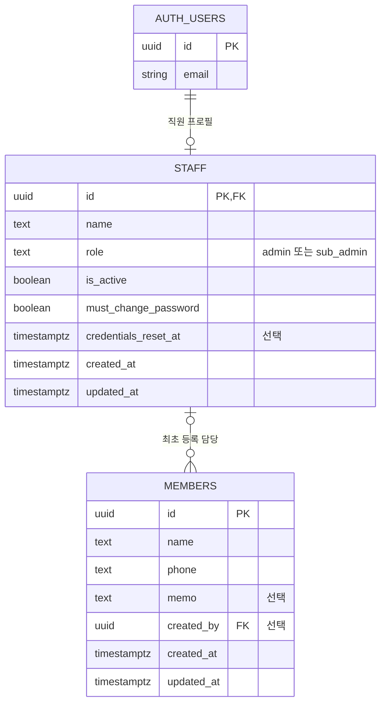

# 직원 및 회원 기본정보 ERD

- 상태: 사용자 확인 완료 — staff 적용, members 미적용
- 최종 갱신: 2026-10-22
- 관련 문서: [로그인 기획](../planning/admin-auth.md), [Supabase 설정](supabase.md)

## 범위

사용자 확정: 한 지점만 관리한다. 헬스 상품과 결제는 추후 고려한다.
이번 ERD는 직원 인증·권한과 회원 기본정보만 제안한다. 회원권·PT·출석·상담 이력도 필요할 때 별도로 기획하며 이번 테이블에는 포함하지 않는다.
로그인 작업에서 staff를 생성했다. members는 후속 회원 관리 기능을 위한 설계 초안이며 지금 생성하거나 구현하지 않는다.

## 관계

AUTH_USERS는 Supabase가 관리하는 auth.users의 개념 표시다. 직접 생성·수정할 앱 테이블이 아니며 실제 인증 정보는 Supabase Auth API로 관리한다. 앱 테이블은 public.staff와 public.members를 제안한다.

## 필드와 정책 제안

| 테이블 | 정책 |
|---|---|
| staff | id는 auth.users.id 참조. Auth 사용자당 최대 한 프로필. 앱 이용에는 활성 프로필 필수 |
| staff | 이름 필수, 역할은 admin/sub_admin 중 하나, 활성 상태 필수. 이메일·비밀번호는 중복 저장하지 않음 |
| members | 이름·연락처 필수, 메모 선택. 생년월일·성별·주소 등 추가 개인정보는 필요 확인 후 도입 |
| members | 회원에게 Auth 계정을 생성하지 않음. 직원과 회원은 서로 다른 대상 |
| members | created_by는 staff.id 참조. 이력 가져오기 등 등록 직원이 없는 경우를 위해 NULL 허용 제안 |
| 공통 | UUID 기본키, 생성·수정 시각은 timestamptz. 입력 검증과 제약·인덱스 상세는 구현 계획에서 확정 |

- 지점 테이블과 branch_id는 도입하지 않는다.
- 회원의 이용 중·만료 상태는 상품·회원권 정책이 정해지기 전에는 만들지 않는다. 직원 is_active는 직원의 접근 허용 여부만 뜻한다.
- 연락처는 정규화해 검색하되 가족 공유 가능성이 있어 유일성 제약을 걸지 않는 안을 제안한다. 중복 안내 정책은 회원 기획에서 확정한다.
- 직원 삭제로 회원 데이터가 삭제되지 않게 한다. 계정은 비활성화 우선이며 향후 영구 삭제가 필요하면 members.created_by는 SET NULL 처리하는 안을 제안한다.
- members의 등록 직원은 이력 기록이며 소유권을 의미하지 않는다. 직원별 회원 접근 권한은 미확정이다.
- 직원 권한 변경은 본인이 할 수 없게 하며 역할·활성 상태를 서버 및 DB 정책으로 검증한다. public 테이블은 RLS와 최소 권한을 적용한다.
- 최초·임시 비밀번호 변경 필수 정책을 확정하여 staff.must_change_password를 추가했다. credentials_reset_at 갱신은 기존 세션 폐기 트리거를 실행한다.

## 후속 확정 항목

- 회원 필수 필드, 중복 연락처 안내, 삭제·보관 정책
- 관리자와 서브관리자의 회원 조회·등록·수정·삭제 권한
- 로그인 비밀번호 및 직원 관리 정책은 확정했다. [실제 기능](../features/admin-auth.md)을 참고한다.

## 검토 결과

2026-10-22: 사용자가 제시된 ERD를 확인했다. 단일 지점, Auth·staff·members 구분, 상품·결제 제외 구조를 후속 계획의 기준으로 사용한다. 회원 세부 정책과 로그인 미결 정책은 별도 확정 대상이다.

문서 관계와 필드·선행 기획을 대조했다. Auth와 직원·회원의 구분, 상품·결제 제외, 회원 데이터 삭제 전파 방지 방향을 확인했다. SQL·앱 코드·원격 DB는 변경하지 않았고 런타임 테스트는 수행하지 않았다.

2026-10-22 후속 구현: staff 테이블·RLS·세션 검증·비밀번호 재설정 트리거 적용 및 테스트 완료. members는 아직 생성하지 않았다. 앞선 DB 미적용 기록은 초기 설계 시점의 이력이다.

## 서브관리자 삭제 연동 (2026-10-22)

관리자가 서브관리자를 삭제할 수 있게 됐다. Auth 삭제 전 staff를 비활성화하고 세션을 폐기한 뒤 auth.users를 삭제하면 현재 staff.id FK의 ON DELETE CASCADE가 직원 프로필도 제거한다. 스키마 변경은 없다. members의 created_by 등 미래 업무 이력 참조는 SET NULL 등의 보존 정책을 별도로 확정해야 하며 이번 삭제에 회원 데이터는 포함되지 않는다.
